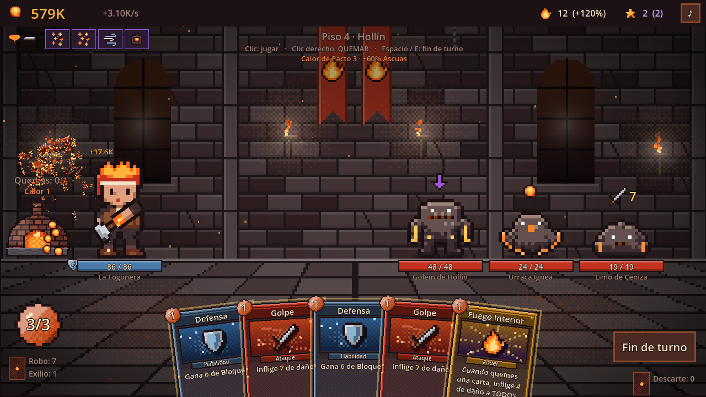

# EMBERSPIRE — *Tu mazo es combustible*

Roguelike de construcción de mazos + incremental, en pixel art, hecho con **Godot 4.7**.

Cada carta de tu mano puede **jugarse** o **quemarse**. Quemarla la pierdes para el combate, pero alimenta
**la Forja** (un motor incremental que produce Ascuas incluso con el juego cerrado) y la carta gana **Maestría**
para siempre. Los generadores de la Forja **Resuenan** y te dan ventajas en la Torre; subir más alto enciende
**Braseros** que multiplican la Forja. La Torre no tiene fin.



## Cómo jugar
1. Abre el proyecto en Godot 4.7 y pulsa **F5** (escena principal `scenes/main.tscn`).
2. En la Forja: clic en el horno, compra generadores (con 10 unidades empiezan a Resonar), mejora tu Arsenal.
3. **Ascender a la Torre** → Antesala (Pactos, reliquias heredadas) → elige puertas, combate, consigue cartas y reliquias.

| Acción | Control |
|---|---|
| Jugar carta | Clic izquierdo (ataques con varios enemigos: clic en carta y luego en enemigo) |
| **Quemar carta** | Clic derecho (o seleccionar y pulsar el horno) |
| Fin de turno | Botón, `Espacio` o `E` |
| Ver mazo de robo / descarte | Clic en las pilas (abajo a izquierda y derecha) |
| Cancelar selección | `Esc` o clic derecho fuera de las cartas |

## Contenido v0.2
- **94 cartas** (90 coleccionables + 4 iniciales) en 7 colecciones (Base, Pira, Yunque, Forja, Ceniza, Crisol, Solar) + 1 ficha y 3 estados
- **14 enemigos, 7 élites y 6 jefes** (dos por acto) con robo de Ascuas, ahogo del horno, invocaciones, espinas y regeneración
- **40 reliquias** (6 de jefe, a elegir 1 de 3) + **21 Resonancias** de generadores
- **16 misterios**, tienda, hogueras, tesoros
- 7 generadores, 11 mejoras de Arsenal, 6 Grimorios, 12 Talentos, Renacer en Ceniza
- **Maestría** de cartas (5 niveles), **Pactos de Brasa** (8), **Reliquario**, **Crónica** de 26 hitos
- Progreso offline, guardado automático (incluida la ascensión en curso; compatible con partidas v0.1)
- Arte y audio 100% procedurales/código: sin binarios en el repositorio

## Qué cambió en v0.2
Ver la tabla de puentes en [Visión](docs/VISION.md#v02--que-cada-sistema-toque-al-otro) y el informe de
[Balance](docs/BALANCE.md), con la simulación de 8 h que guió el ajuste.

## Documentación del estudio
[Visión](docs/VISION.md) · [Equipo](docs/TEAM.md) · [GDD](docs/GDD.md) · [Arquitectura](docs/ARCHITECTURE.md) ·
[Biblia de arte](docs/ART_BIBLE.md) · [Balance](docs/BALANCE.md) · [QA](docs/QA.md)

## Tests
```bash
GODOT=/ruta/a/godot ./tests/run_tests.sh
```
Simulaciones: `res://tests/balance_sim.tscn`, `res://tests/progression_sim.tscn -- <horas>` · Capturas: `res://tests/smoke.tscn`.
