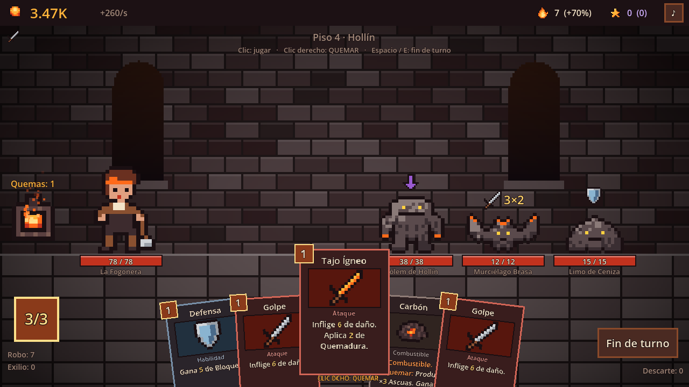

# EMBERSPIRE — *Tu mazo es combustible*

Roguelike de construcción de mazos + incremental, en pixel art, hecho con **Godot 4.7**.

Cada carta de tu mano puede **jugarse** o **quemarse**. Quemarla la pierdes para el combate, pero alimenta
**la Forja**: un motor incremental que produce Ascuas incluso con el juego cerrado y que te hace más fuerte en la Torre.
Subir más alto enciende **Braseros** que multiplican la Forja. La Torre no tiene fin.



## Cómo jugar
1. Abre el proyecto en Godot 4.7 y pulsa **F5** (escena principal `scenes/main.tscn`).
2. En la Forja: clic en el horno, compra generadores, mejora tu Arsenal.
3. **Ascender a la Torre**: elige puertas, combate, consigue cartas y reliquias.

| Acción | Control |
|---|---|
| Jugar carta | Clic izquierdo (ataques con varios enemigos: clic en carta y luego en enemigo) |
| **Quemar carta** | Clic derecho (o seleccionar y pulsar el horno) |
| Fin de turno | Botón, `Espacio` o `E` |
| Cancelar selección | `Esc` o clic derecho fuera de las cartas |

## Contenido v0.1
- 39 cartas en 5 colecciones (Base, Pira, Yunque, Ceniza, Solar) + 2 cartas de estado
- 13 enemigos y élites, 3 jefes, 3 actos y ciclos infinitos con mutaciones procedurales
- 12 reliquias, 5 misterios, tienda, hogueras, tesoros
- 7 generadores, 11 mejoras de Arsenal (2 infinitas), 4 Grimorios, 6 Talentos, Renacer en Ceniza
- Progreso offline, guardado automático (incluida la ascensión en curso)
- Arte y audio 100% procedurales/código: sin binarios en el repositorio

## Documentación del estudio
[Visión](docs/VISION.md) · [Equipo](docs/TEAM.md) · [GDD](docs/GDD.md) · [Arquitectura](docs/ARCHITECTURE.md) ·
[Biblia de arte](docs/ART_BIBLE.md) · [Balance](docs/BALANCE.md) · [QA](docs/QA.md)

## Tests
```bash
GODOT=/ruta/a/godot ./tests/run_tests.sh
```
