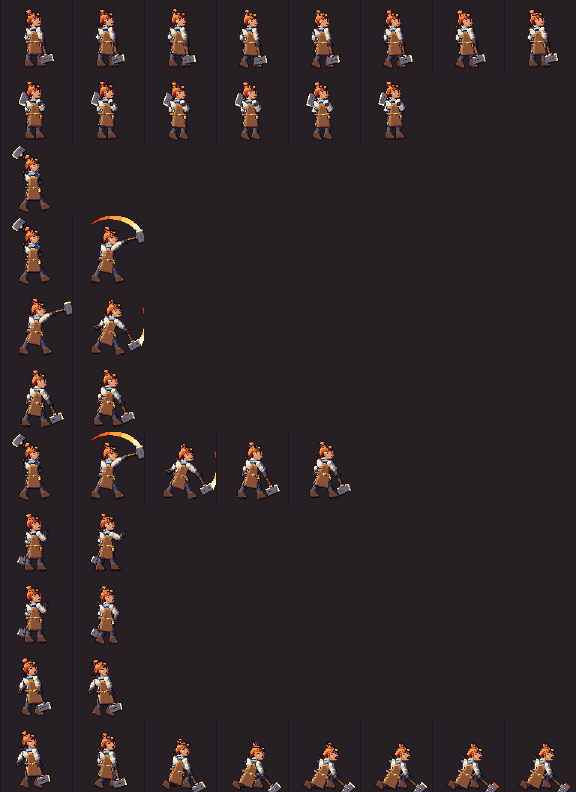
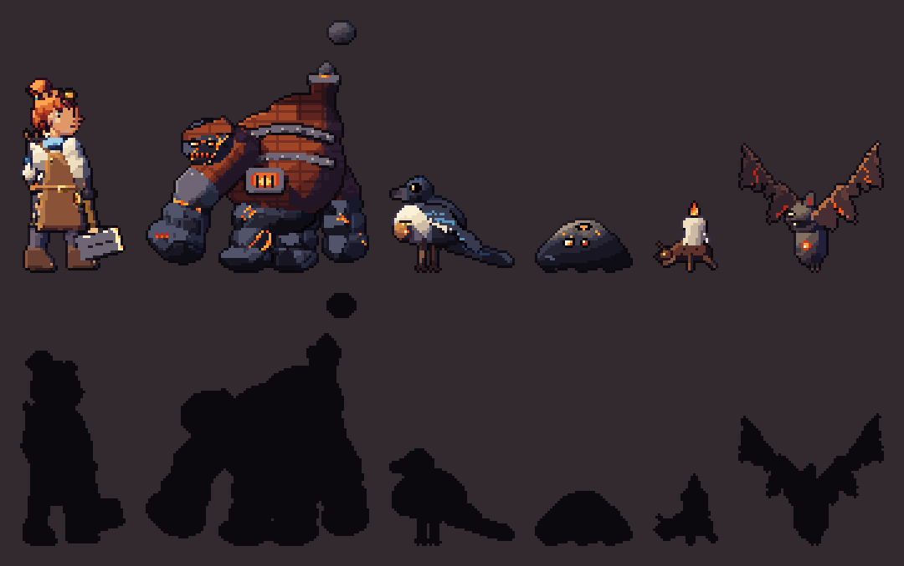
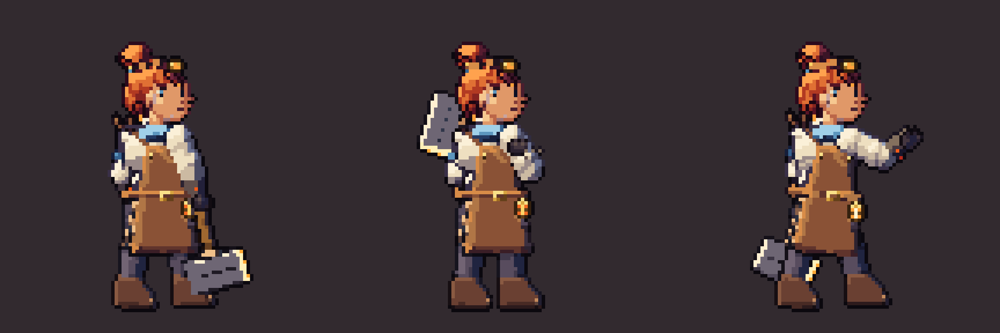

# La Fogonera — hoja de diseño final (v0.4)

Este es el diseño de PER con las enmiendas de DA (`DEBATE.md` → Resolución), ya **portado al motor de rig de TEC** y horneado en `assets/baked/hero/`.

- **Fuente:** `scripts/art/defs/hero/fogonera.gd` (huesos, piezas, poses como articulaciones) y `scripts/art/defs/stamps/stamp_lib.gd` (sellos).
- **Hojas de revisión:** `scripts/art/defs/tools/sheet_per.gd`, `zoom_per.gd`, `lineup_per.gd` → `img/`.
- **Prueba:** `tests/art/test_per.gd`.

*Todas las animaciones (×3). Fila = animación.*

*Reparto del acto 1 a escala real, con siluetas.*

## Medidas
- **Lienzo de pose:** 96×96, pies en y = 89, mira a la derecha.
- **Alto:** 66 px de bota a coronilla, más 6 px de moño.
- **Cabeza:** 15 px. La cara sellada mide 12×12.
- **Proporciones:** 4,4 cabezas. Hombros de 22 px, cadera de 15 px, botas de 12 px.
- **Escala:** a ×2 (mundo de 640×360) ocupa 132 px de pantalla, el mismo alto que la heroína v0.3.

## Piezas y enmiendas de DA
| Pieza | Diseño | Enmienda aplicada |
|---|---|---|
| **Cara** | Sello `face_34`, 12×12, con 4 variantes: neutra, esfuerzo, herida y perfil. Fila 0 = flequillo. Ojo cercano 1×2 (brillo `wool_blue 4` sobre iris `wool_blue 0`) con blanco `linen 5`. Ojo lejano 1×2. Ceja de 3 px. La nariz rompe la silueta 2 px. Boca de 2 px. | Cara sellada ≥ 10×10 legible. La mandíbula **no** lleva sombra inferior (evita la «barba»). |
| **Pelo** | Casquete y moño por primitivas (`hair`, textura de mechones) y 3 sellos de mechón: `lock_fringe`, `lock_nape`, `lock_bun_tail`. | Las **puntas** son `fire 5` si `heat > 0,35`; si no, `hair 2`. Siguen al calor actual. |
| **Gafas de forja** | Sello `goggles` 5×4: latón y cristal que refleja la Forja (`fire 5`), con correa de cuero. | Subidas 2 px: quedan sobre el pelo, no sobre los ojos. |
| **Bufanda** | `wool_blue`: cuello + cola al aire. Es el único frío de su paleta. | — |
| **Fuelle** | Sello `bellows_handles`: sólo asoman 2 asas sobre el hombro lejano, más la correa cruzada al pecho. | El cuerpo del fuelle no se ve. |
| **Fogón de cinto** | Sello `belt_lantern` 5×6: farol de latón con rejilla. Las barras `f`/`g` son emisivas (`fire 4/6`) y el shader les suma el pulso de quemar. | — |
| **Martillo** | Cabeza de `iron` (17×10, con bisel y ranura de forja), collarín de `steel`, mango de `wood`. **La cara de golpe es `hot`**: paso 1 en frío, paso 5 en caliente. | Sigue al calor actual. |
| **Manos** | Antebrazos tiznados (`soot`) con 2 cicatrices de chispa emisivas. Manos con sellos `hand_grip`, `hand_grip_knuckles`, `hand_fist` y `hand_open` (ranura `@hand` → `soot`). | Manos siempre selladas. |
| Saco de carbón | — | **Eliminado.** |
| Tenazas | Cuelgan del cinto, en el lado lejano. | — |
| **Segundo reposo** | `shoulder`: el martillo descansa en el hombro y la cabeza del martillo asoma detrás del moño. Es para Antesala, Hoguera y victoria. | Hecho. |

*Reposo, reposo con el martillo al hombro y habilidad (×8).*

## Paleta (materiales de `Palette`, pasos que usa la luz calculada)
`skin 1–5` · `hair 1–5` (más puntas `fire`) · `linen 1–5` · `leather 1–5` · `canvas 1–5` · `boot 1–5` · `soot 1–5` · `iron 2–8` · `steel 1–5` · `wood 2–8` · `brass` (sólo en sellos) · `wool_blue 1–5` · `hot` y `fire` (emisivos, sólo en sellos y trazos).

El contorno es el paso 0 del material; en el lado iluminado se usa el paso 1 (sel-out). No hay ningún hex escrito a mano.

## Poses → claves del esqueleto bípedo (para el motor de TEC)
Cada pose de `POSES` define las articulaciones del esqueleto bípedo:
- **Cabeza y torso:** `head`, `chest`, `waist`.
- **Brazo cercano:** `sh_n`, `el_n`, `wr_n`.
- **Brazo lejano:** `sh_f`, `el_f`, `wr_f`.
- **Pierna trasera:** `hip_b`, `kn_b`, `an_b`.
- **Pierna delantera:** `hip_f`, `kn_f`, `an_f`.
- **Martillo:** `hammer`.

Además lleva la elección de sellos (`face`, `hand_n`, `hand_f`) y unas banderas de profundidad:
- `z_arm_behind_head`: en la carga, el brazo pasa por detrás de la cabeza;
- `hammer_behind_head`: reposo al hombro;
- `hammer_in_far_hand`: el martillo va en la mano lejana (pose de lanzar).

Con IK de dos huesos, `wr`/`an` son los objetivos y `el`/`kn` las pistas de codo y rodilla.

**Animaciones horneadas** (ms):

| Animación | Fotogramas |
|---|---|
| `idle` | 8 × 150, respiración de 1 px, moño y bufanda con retardo, el farol parpadea |
| `idle_shoulder` | 6 × 160 |
| `windup`, `smear`, `strike`, `recover` | piezas sueltas; `attack` (5) las encadena: 140, 33, 90, 90, 120 |
| `cast` (habilidad) | 2 |
| `toss` (quemar) | 2: el farol sube 3 pasos |
| `hurt` | 2 |
| `death` | 8: cae de rodillas, el farol se apaga |

La victoria (4 f) no está en el encargo de esta fase.

## Pendiente (honesto)
- **Manos:** mano tiznada de 5 px. Se lee en golpe y en habilidad; en el reposo al hombro lleva parche (3 nudillos) pero sigue siendo una masa oscura sobre el lino.
- **Ojo lejano:** 1×2 oscuro junto a la nariz. Revisado a ×8: se lee como ojo en la cara neutra; a ×1 es una marca oscura. Lo dejo así.
- **Sellos sin rotación:** la cara no gira con la cabeza (aviso de TEC). En la muerte, con la cabeza caída, sigue vertical: se nota poco.
- **La luz fría sobre la cara** daba un parche gris que parecía un moratón: el cráneo va con `flat 0.95` para que domine la cálida.
